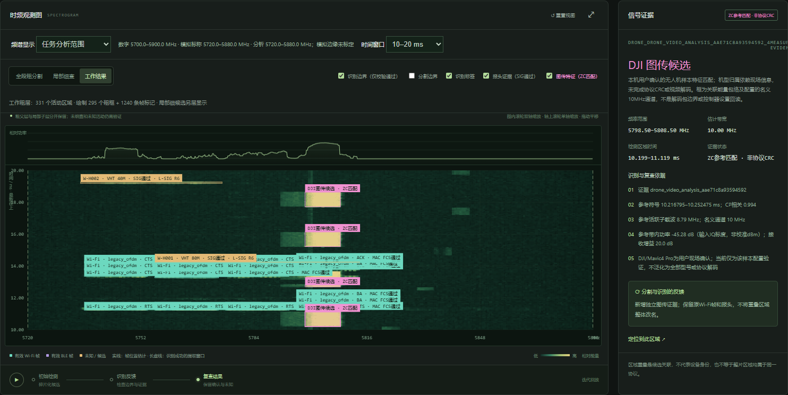
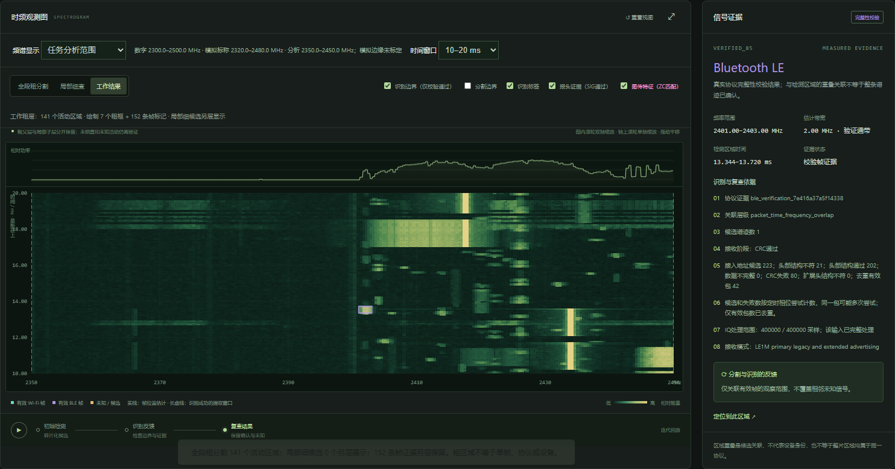
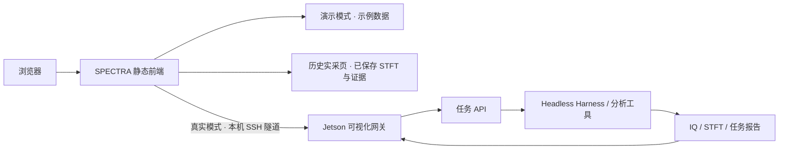

<div align="center">

# SPECTRA

### 频谱智能观测台 · Spectrum Intelligence Console

从时频活动到识别证据，让信号分析过程可观察、可交互、可回溯。

[](https://github.com/zh-zehui/spectra-console-ui/actions/workflows/checks.yml)
[](https://zh-zehui.github.io/spectra-console-ui/)


[**查看历史实采任务 ↗**](https://zh-zehui.github.io/spectra-console-ui/measured/) · [交互演示](https://zh-zehui.github.io/spectra-console-ui/) · [边缘端源码](edge/) · [Jetson 部署](docs/edge-deployment.md)



</div>

SPECTRA 是面向频谱分析的独立可视化操作层，将任务描述、时频观测、候选分割、识别证据和历史报告放到同一工作台。前端使用原生 HTML / CSS / JavaScript，静态演示无需后端或硬件。

> **实采任务页**读取已归档的真实 RF 任务、STFT 数值和证据条目；**交互演示工作台**使用明确标注的示例数据。两者均不发起现场采集。`edge/` 包含从实际 Jetson 读取的后端、网关、分析插件及部署代码；实时设备模式仍需安装无线环境和原生依赖。项目不隶属于 DeepSeek。

## 历史实采任务

从 Jetson 的任务记录读取 **19 条当前可见历史任务**，保留 `succeeded` / `partial` 状态，并整理 **4 个分析案例、3 份独立采集记录**。全部精选案例的采集元数据均为 `kind=rf_capture`、`simulated=false`，接收机为 USRP X310。

| 历史分析案例 | 实采记录参数 | 网关导出的证据观测 |
| --- | --- | --- |
| [2.4 GHz · Wi-Fi 与 BLE](https://zh-zehui.github.io/spectra-console-ui/measured/#wifi-ble-24) | 100 MHz 分析范围 · 200 MS/s · 100 ms | Wi-Fi 校验帧 81，BLE 校验帧 71，独立 PHY 报头 7 |
| [5.8 GHz · 宽带协议检查](https://zh-zehui.github.io/spectra-console-ui/measured/#wifi-58) | 160 MHz 分析范围 · 200 MS/s · 500 ms | Wi-Fi 校验帧 1007，独立 PHY 报头 99 |
| [5.8 GHz · Wi-Fi 与图传候选](https://zh-zehui.github.io/spectra-console-ui/measured/#mixed-link) | 与上一案例复用同一份 IQ · 500 ms | Wi-Fi 校验帧 1240，参考特征匹配 196；两类证据独立保留 |
| [5.8 GHz · 20 MHz 图传候选](https://zh-zehui.github.io/spectra-console-ui/measured/#link-candidate) | 另一份 160 MHz 范围的实采 IQ · 500 ms | ZC601/root252 特征匹配 190；尚无协议 CRC 或视频解码 |

**2.4 GHz 的真实局部 STFT 与 BLE 校验帧证据：**



实采页可切换案例、查看真实 STFT 预览数值、筛选证据层级、下载筛选字段后的 JSON，并查看原始采集时间与来源任务 ID。上面的工作台截图为从原 IQ 重新读取 **10–20 ms 局部窗口**后的结果；归档页提供的是 **完整记录的 192×512 最大池化预览**。

图传候选属于样本参考特征匹配，不能等同于完整协议识别；模板来自同一采集记录的短窗口，匹配数包含该区间，不是独立测试准确率。任务复用 IQ 不等于重新采集，计数不能当作设备数。[查看任务来源、各案例截图与限制](docs/measured-results.md)。

## 看点

| 能力 | 交互体验 |
| --- | --- |
| 自然语言任务 | 输入观测描述，精确设置中心频率、带宽、采样率和观测时间 |
| 可交互时频图 | 频率/时间缩放、拖动平移、候选边界和识别标签叠加 |
| 分割与证据联动 | 在初始分割、反馈复查和最终结果之间切换，查看边界变化 |
| 信号证据面板 | 点击目录或图中区域，查看频率范围、验证依据与待确认项 |
| 任务回溯 | 查看历史任务、阶段耗时，并导出带来源标记的 JSON 报告 |
| 展示与移动端 | 一键收起导航进入展示模式，适配窄屏浏览 |

## 交互演示预览（示例数据）


**初始分割：保留碎片化候选，观察分析起点。**


**证据复查：选择未知活动，查看依据和仍需验证的部分。**


<details>
<summary>查看移动端长截图</summary>


</details>

本节截图来自静态交互演示，使用示例数据；上方“历史实采任务”的截图与数据另有真实采集来源。更新方式见 [维护指南](CONTRIBUTING.md)。

## 一分钟体验

1. 打开 [在线演示](https://zh-zehui.github.io/spectra-console-ui/)，在 2.4 GHz 与 5.8 GHz 示例间切换。
2. 点击“发送提示词”，观察演示任务的阶段变化。
3. 切换“初始分割 / 反馈复查 / 最终结果”，点击信号目录中的一行查看对应证据。
4. 滚轮缩放、拖动平移；点击“重置视图”恢复范围。
5. 使用“展示模式”讲解界面，按 Esc 恢复；导出 JSON 报告或打开任务记录。

## 本地运行

安装 Node.js 22 或更高版本后：

```sh
git clone https://github.com/zh-zehui/spectra-console-ui.git
cd spectra-console-ui
npm start
```

打开 **http://127.0.0.1:4173/** 体验示例交互，或打开 **http://127.0.0.1:4173/measured/** 查看历史实采任务。静态页面运行不需要安装 npm 依赖，也不需要 API Key。`npm ci` 和 Playwright 仅用于开发检查与截图。

也可使用任意静态服务器托管 `dist/`。外部字体无法加载时会使用系统字体。

## 工作方式



本仓库包含静态前端、实采记录的公开摘录、Windows 连接脚本和 `edge/` 边缘端部署源码。在线站点只托管静态文件；实时任务由设备端服务执行。详见 [Jetson 部署指南](docs/edge-deployment.md) 与 [设备启动、停止及数据边界](docs/device-setup.md)。

## 边缘端部署代码

[`edge/`](edge/) 从现有 Jetson 的实际运行目录导出，包含 Python API / 队列 / 采集 / DSP / 报告、可视化网关、DSH 工具插件、原生接收工具、构建与启停脚本，以及 Python / npm / Cargo 依赖文件。六个第三方仓库固定到原设备提交，其中三个保留部署补丁及上游许可证。

源码快照附有逐文件 SHA-256，可运行 `python3 edge/deploy/verify.py --source-only` 核对。环境准备、第三方源码恢复、凭据配置、原生构建、SSH 访问和服务启停见 [部署指南](docs/edge-deployment.md)。

当前快照保留 `/home/sribd/spectrum_agent` 和 `usrp_dev` 的已验证布局；系统无线环境、编译产物、密钥与原始 IQ 需在目标设备另行准备。尚未在空白 Jetson 上完成全流程安装验收。

## 工程结构

```text
dist/                     静态前端，直接编辑、直接运行
edge/                     Jetson 后端、分析插件、依赖锁及部署脚本
dist/measured/            只读实采归档页、STFT 数值、证据条目与实采截图
docs/screenshots/         README 使用的真实界面截图
docs/measured-results.md  历史实采案例、来源与证据限制
docs/edge-deployment.md   当前 Jetson 部署布局、环境准备及服务操作
docs/device-setup.md      现有 Jetson 环境接入说明与历史验证记录
scripts/serve.mjs         本地演示服务器，仅监听本机
tests/demo.mjs            桌面/移动端浏览器交互检查与截图
tests/measured.mjs        实采归档来源、计数、只读行为与移动端检查
.github/workflows/        自动检查与 Pages 演示部署
Open-Spectra.cmd/.ps1     连接已部署的 Jetson 服务
Stop-Spectra.cmd/.ps1     检查/停止设备服务与匹配的独立隧道
```

## 结果如何解读

- 演示中的信号、协议标签、校验结果与耗时均为示意，不是现场测量或性能基准。
- 波形外观、频段匹配及区域重叠不能单独确认协议或设备身份；unknown、partial、failed 状态按原意保留。
- 真实时频图功率未做绝对校准，部分接收器与边界估计仍属实验性；具体限制见设备说明。

欢迎通过 [Issues](https://github.com/zh-zehui/spectra-console-ui/issues) 提交问题或建议；界面贡献请附截图与验证结果。
