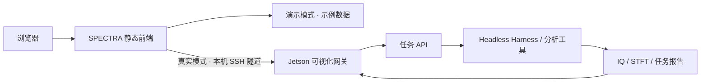

<div align="center">

# SPECTRA

### 频谱智能观测台 · Spectrum Intelligence Console

从时频活动到识别证据，让信号分析过程可观察、可交互、可回溯。

[](https://github.com/zh-zehui/spectra-console-ui/actions/workflows/checks.yml)
[](https://zh-zehui.github.io/spectra-console-ui/)


[**打开在线演示 ↗**](https://zh-zehui.github.io/spectra-console-ui/) · [本地运行](#本地运行) · [设备接入](docs/device-setup.md) · [参与维护](CONTRIBUTING.md)


</div>

SPECTRA 是面向频谱分析的独立可视化操作层，将任务描述、时频观测、候选分割、识别证据和历史报告放到同一工作台。前端使用原生 HTML / CSS / JavaScript，静态演示无需后端或硬件。

> 在线演示使用明确标注的示例数据，不执行射频采集。真实设备模式需要额外部署 Jetson 网关与任务 API；这些服务和底层分析工具不包含在本仓库中。项目不隶属于 DeepSeek。

## 看点

| 能力 | 交互体验 |
| --- | --- |
| 自然语言任务 | 输入观测描述，精确设置中心频率、带宽、采样率和观测时间 |
| 可交互时频图 | 频率/时间缩放、拖动平移、候选边界和识别标签叠加 |
| 分割与证据联动 | 在初始分割、反馈复查和最终结果之间切换，查看边界变化 |
| 信号证据面板 | 点击目录或图中区域，查看频率范围、验证依据与待确认项 |
| 任务回溯 | 查看历史任务、阶段耗时，并导出带来源标记的 JSON 报告 |
| 展示与移动端 | 一键收起导航进入展示模式，适配窄屏浏览 |

## 界面预览

**初始分割：保留碎片化候选，观察分析起点。**


**证据复查：选择未知活动，查看依据和仍需验证的部分。**


<details>
<summary>查看移动端长截图</summary>


</details>

截图来自本仓库的静态演示，通过浏览器实际运行生成。更新方式见 [维护指南](CONTRIBUTING.md)。

## 一分钟体验

1. 打开 [在线演示](https://zh-zehui.github.io/spectra-console-ui/)，在 2.4 GHz 与 5.8 GHz 示例间切换。
2. 点击“发送提示词”，观察演示任务的阶段变化。
3. 切换“初始分割 / 反馈复查 / 最终结果”，点击信号目录中的一行查看对应证据。
4. 滚轮缩放、拖动平移；点击“重置视图”恢复范围。
5. 使用“展示模式”讲解界面，按 Esc 恢复；导出 JSON 报告或打开任务记录。

## 本地运行

安装 Node.js 22 或更高版本后：

```sh
git clone https://github.com/zh-zehui/spectra-console-ui.git
cd spectra-console-ui
npm start
```

打开 **http://127.0.0.1:4173/**。演示运行不需要安装 npm 依赖，也不需要 API Key。`npm ci` 和 Playwright 仅用于开发检查与截图。

也可使用任意静态服务器托管 `dist/`。外部字体无法加载时会使用系统字体。

## 工作方式



本仓库包含静态前端和 Windows 连接脚本。在线演示只托管静态文件；真实任务由设备端服务执行。详见 [真实设备启动、停止与数据边界](docs/device-setup.md)。

## 工程结构

```text
dist/                     静态前端，直接编辑、直接运行
docs/screenshots/         README 使用的真实界面截图
docs/device-setup.md      现有 Jetson 环境接入说明与历史验证记录
scripts/serve.mjs         本地演示服务器，仅监听本机
tests/demo.mjs            桌面/移动端浏览器交互检查与截图
.github/workflows/        自动检查与 Pages 演示部署
Open-Spectra.cmd/.ps1     连接已部署的 Jetson 服务
Stop-Spectra.cmd/.ps1     检查/停止设备服务与匹配的独立隧道
```

## 结果如何解读

- 演示中的信号、协议标签、校验结果与耗时均为示意，不是现场测量或性能基准。
- 波形外观、频段匹配及区域重叠不能单独确认协议或设备身份；unknown、partial、failed 状态按原意保留。
- 真实时频图功率未做绝对校准，部分接收器与边界估计仍属实验性；具体限制见设备说明。

欢迎通过 [Issues](https://github.com/zh-zehui/spectra-console-ui/issues) 提交问题或建议；界面贡献请附截图与验证结果。
