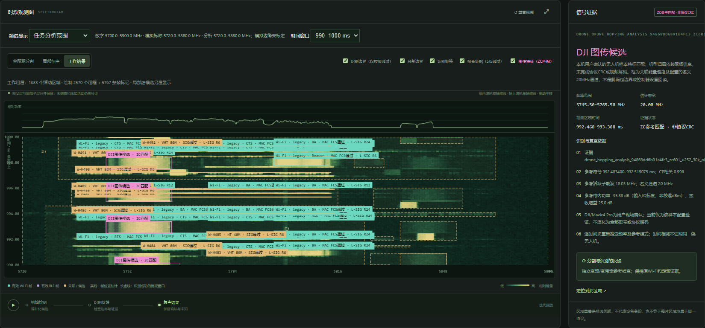
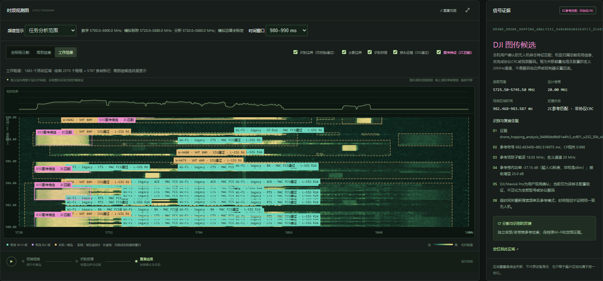
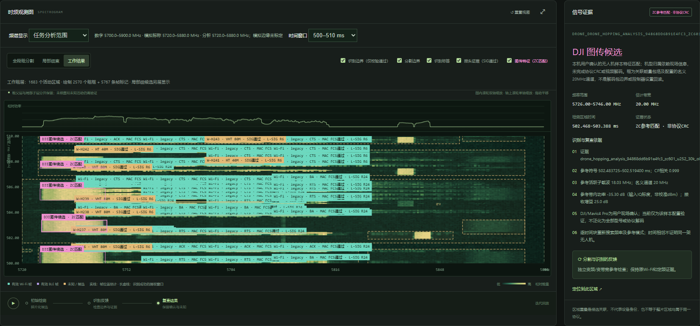
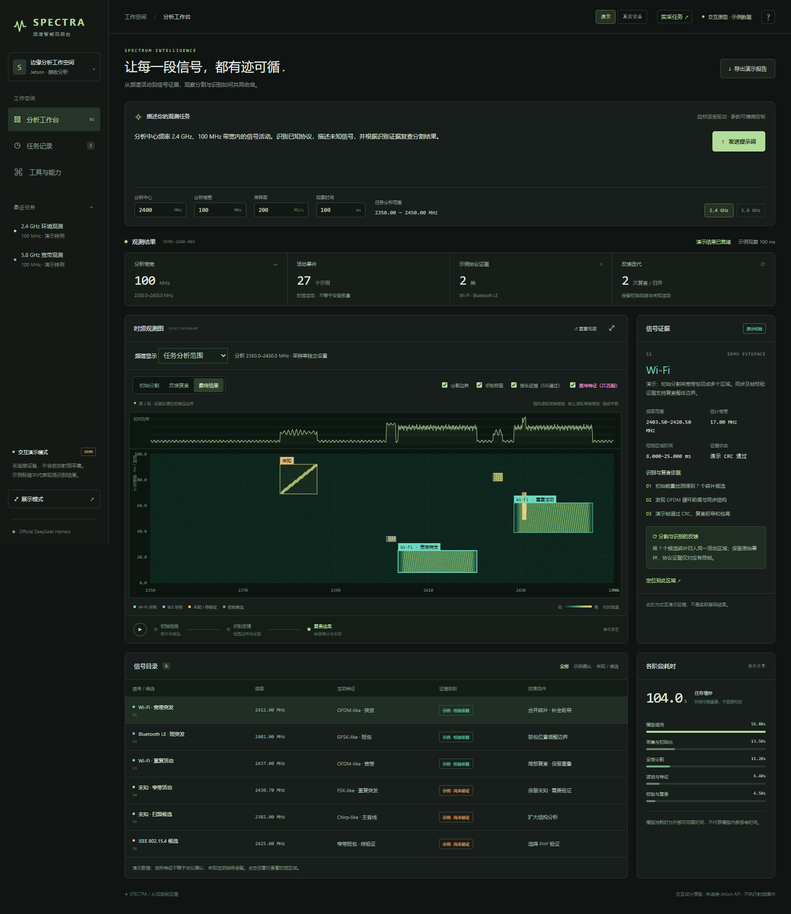
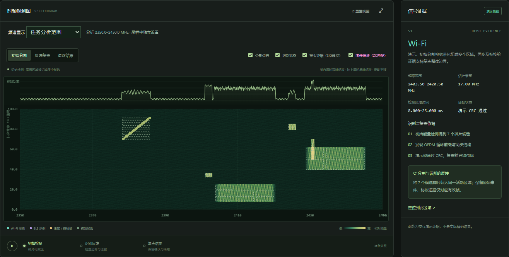
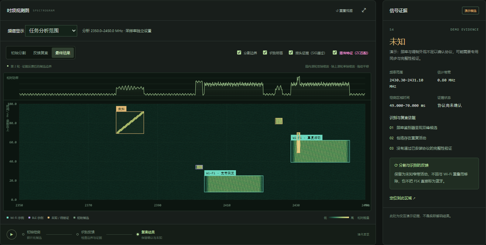
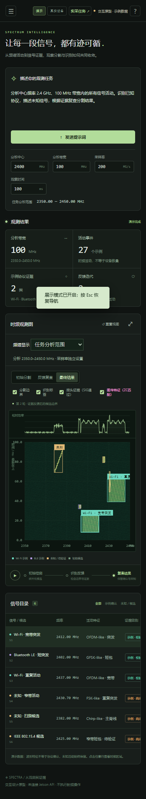
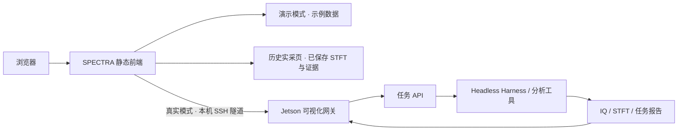

<div align="center">

# SPECTRA

### 频谱智能观测台 · Spectrum Intelligence Console

从时频活动到识别证据，让信号分析过程可观察、可交互、可回溯。

[](https://github.com/zh-zehui/spectra-console-ui/actions/workflows/checks.yml)
[](https://zh-zehui.github.io/spectra-console-ui/)


[**查看历史实采任务 ↗**](https://zh-zehui.github.io/spectra-console-ui/measured/) · [交互演示](https://zh-zehui.github.io/spectra-console-ui/) · [边缘端源码](edge/) · [Jetson 部署](docs/edge-deployment.md)



</div>

SPECTRA 是面向频谱分析的独立可视化操作层，将任务描述、时频观测、候选分割、识别证据和历史报告放到同一工作台。前端使用原生 HTML / CSS / JavaScript，静态演示无需后端或硬件。

> **实采任务页**读取已归档的真实 RF 任务、STFT 数值和证据条目；**交互演示工作台**使用明确标注的示例数据。两者均不发起现场采集。`edge/` 包含从实际 Jetson 读取的后端、网关、分析插件及部署代码；实时设备模式仍需安装无线环境和原生依赖。项目不隶属于 DeepSeek。

## 历史实采任务

仅展示指定任务 **[`task_agile_full_292630d126a1`](https://zh-zehui.github.io/spectra-console-ui/measured/)**：USRP X310 的真实 RF 记录，`kind=rf_capture`、`simulated=false`，状态 `succeeded`。

| 记录与证据 | 网关原始结果 |
| --- | --- |
| 采集与分析范围 | 中心 5800 MHz · 分析范围 5720–5880 MHz · 200 MS/s · 1000 ms |
| 原始样本 | 200,000,000 个复样本，记录完整，无 overflow / gap |
| Wi-Fi / PHY | 5767 条 Wi-Fi 校验帧，492 条独立 PHY 报头 |
| 图传参考特征 | 395 条候选，名义 20 MHz；候选频率在记录末段发生变化 |
| 检查范围 | 协议计划 70/70 项；图传候选检查 100/100 时间单元 |

**同一任务 980–990 ms 的局部 STFT，可与上方 990–1000 ms 对照：**



四张截图均在对应局部 STFT 加载完成后截取，开启校验帧、PHY 报头、图传候选和粗分割图层，并逐项核对当前窗口的证据：

| 时间窗口 | Wi-Fi 校验帧 | PHY 报头 | 图传候选 | 粗活动区域 |
| --- | --- | --- | --- | --- |
| 10–20 ms | 69 | 4 | 5 | 18 |
| 500–510 ms | 100 | 8 | 5 | 10 |
| 980–990 ms | 75 | 6 | 5 | 14 |
| 990–1000 ms | 51 | 10 | 4 | 15 |

**10–20 ms：**


**500–510 ms：**



实采页可切换这一个任务的四个 10 ms 局部时频窗口及完整 0–1000 ms 记录。局部视图使用已保存的原 IQ STFT 数值，当前窗口的所有已开启证据图层均参与绘制，不受下方列表前 12 条限制；同时提供证据筛选、JSON 下载和采集来源核对。

参考序列在约 987.48–992.48 ms 出现 5736 → 5758 → 5755.5 MHz 的候选变化，关联仅依据时序相容性，不确认同一发射机或解码跳频规律。本任务没有检出带宽变化；特征匹配也不等于协议 CRC 或视频解码。[查看此任务的来源与证据限制](docs/measured-results.md)。

## 看点

| 能力 | 交互体验 |
| --- | --- |
| 自然语言任务 | 输入观测描述，精确设置中心频率、带宽、采样率和观测时间 |
| 可交互时频图 | 频率/时间缩放、拖动平移、候选边界和识别标签叠加 |
| 分割与证据联动 | 在初始分割、反馈复查和最终结果之间切换，查看边界变化 |
| 信号证据面板 | 点击目录或图中区域，查看频率范围、验证依据与待确认项 |
| 任务回溯 | 查看历史任务、阶段耗时，并导出带来源标记的 JSON 报告 |
| 展示与移动端 | 一键收起导航进入展示模式，适配窄屏浏览 |

## 交互演示预览（示例数据）

以下为示例模式缩略图，点击可查看原图；实采结果见上方指定任务。

<table>
<tr>
<td align="center"><a href="docs/screenshots/workbench.png"></a><br>示例工作台</td>
<td align="center"><a href="docs/screenshots/initial-segmentation.png"></a><br>初始分割</td>
<td align="center"><a href="docs/screenshots/evidence.png"></a><br>证据联动</td>
</tr>
</table>

<details>
<summary>查看移动端长截图</summary>

<a href="docs/screenshots/mobile.png"></a>

</details>

本节截图来自静态交互演示，使用示例数据；上方“历史实采任务”的截图与数据另有真实采集来源。更新方式见 [维护指南](CONTRIBUTING.md)。

## 一分钟体验

1. 打开 [在线演示](https://zh-zehui.github.io/spectra-console-ui/)，在 2.4 GHz 与 5.8 GHz 示例间切换。
2. 点击“发送提示词”，观察演示任务的阶段变化。
3. 切换“初始分割 / 反馈复查 / 最终结果”，点击信号目录中的一行查看对应证据。
4. 滚轮缩放、拖动平移；点击“重置视图”恢复范围。
5. 使用“展示模式”讲解界面，按 Esc 恢复；导出 JSON 报告或打开任务记录。

## 本地运行

安装 Node.js 22 或更高版本后：

```sh
git clone https://github.com/zh-zehui/spectra-console-ui.git
cd spectra-console-ui
npm start
```

打开 **http://127.0.0.1:4173/** 体验示例交互，或打开 **http://127.0.0.1:4173/measured/** 查看历史实采任务。静态页面运行不需要安装 npm 依赖，也不需要 API Key。`npm ci` 和 Playwright 仅用于开发检查与截图。

也可使用任意静态服务器托管 `dist/`。外部字体无法加载时会使用系统字体。

## 工作方式



本仓库包含静态前端、实采记录的公开摘录、Windows 连接脚本和 `edge/` 边缘端部署源码。在线站点只托管静态文件；实时任务由设备端服务执行。详见 [Jetson 部署指南](docs/edge-deployment.md) 与 [设备启动、停止及数据边界](docs/device-setup.md)。

## 边缘端部署代码

[`edge/`](edge/) 从现有 Jetson 的实际运行目录导出，包含 Python API / 队列 / 采集 / DSP / 报告、可视化网关、DSH 工具插件、原生接收工具、构建与启停脚本，以及 Python / npm / Cargo 依赖文件。六个第三方仓库固定到原设备提交，其中三个保留部署补丁及上游许可证。

源码快照附有逐文件 SHA-256，可运行 `python3 edge/deploy/verify.py --source-only` 核对。环境准备、第三方源码恢复、凭据配置、原生构建、SSH 访问和服务启停见 [部署指南](docs/edge-deployment.md)。

当前快照保留 `/home/sribd/spectrum_agent` 和 `usrp_dev` 的已验证布局；系统无线环境、编译产物、密钥与原始 IQ 需在目标设备另行准备。尚未在空白 Jetson 上完成全流程安装验收。

## 工程结构

```text
dist/                     静态前端，直接编辑、直接运行
edge/                     Jetson 后端、分析插件、依赖锁及部署脚本
dist/measured/            只读实采归档页、STFT 数值、证据条目与实采截图
docs/screenshots/         README 使用的真实界面截图
docs/measured-results.md  历史实采案例、来源与证据限制
docs/edge-deployment.md   当前 Jetson 部署布局、环境准备及服务操作
docs/device-setup.md      现有 Jetson 环境接入说明与历史验证记录
scripts/serve.mjs         本地演示服务器，仅监听本机
tests/demo.mjs            桌面/移动端浏览器交互检查与截图
tests/measured.mjs        实采归档来源、计数、只读行为与移动端检查
.github/workflows/        自动检查与 Pages 演示部署
Open-Spectra.cmd/.ps1     连接已部署的 Jetson 服务
Stop-Spectra.cmd/.ps1     检查/停止设备服务与匹配的独立隧道
```

## 结果如何解读

- 演示中的信号、协议标签、校验结果与耗时均为示意，不是现场测量或性能基准。
- 波形外观、频段匹配及区域重叠不能单独确认协议或设备身份；unknown、partial、failed 状态按原意保留。
- 真实时频图功率未做绝对校准，部分接收器与边界估计仍属实验性；具体限制见设备说明。

欢迎通过 [Issues](https://github.com/zh-zehui/spectra-console-ui/issues) 提交问题或建议；界面贡献请附截图与验证结果。
