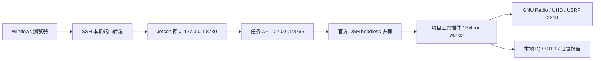

# Jetson 边缘端部署

[边缘端源码](../edge/) · [源码快照](../edge/deploy/source-snapshot.json) · [Windows 连接方式](device-setup.md)

本指南依据当前 Jetson 的实际启动脚本、Python 虚拟环境和依赖锁文件整理。原有 API 与 UI 的健康接口已读取核对；新增准备脚本尚未在一台空白 Jetson 上完成从零部署验收。

## 当前部署结构



| 项目 | 现有部署基线 |
| --- | --- |
| 架构 | Linux aarch64 / Jetson |
| 后端路径 | `/home/sribd/spectrum_agent` |
| 无线环境 | `/home/sribd/miniforge3/envs/usrp_dev`，已有 GNU Radio / UHD / NumPy / SciPy |
| 后端 Python | 3.11.9；`.venv` 由无线环境 Python 创建，启用 `--system-site-packages` |
| 系统 Python | 3.12.3；不是现有后端虚拟环境的解释器 |
| Node.js | 当前 24.22.1，项目路径 `runtime/node/bin/node` |
| DSH | `@deepseek-ai/dsh` 0.2.1-rc.2，依赖位于 `runtime/dsh` |
| 接收硬件 | USRP X310 / UBX-160；采集代码当前默认地址 `192.168.10.2` |
| 自启 | 当前未配置 systemd 或开机自启；由启动脚本按需拉起 |

源码中现存的构建脚本、停止脚本及 DSH 插件路径仍绑定此目录和无线环境。`SPECTRUM_ROOT` 不能自动覆盖所有脚本中的绝对路径。其他用户名、架构或 Python ABI 需要逐项适配，不能只移动目录。

## 1. 准备基础环境与代码

目标机器需先有可导入 GNU Radio、UHD、NumPy、SciPy 的兼容无线环境，以及可用的 C/C++ 编译器、Git、CMake/Ninja。额外原生依赖按后面的接收器构建要求准备。本仓库不包含原设备的 Conda 环境和编译好的动态库。

在使用相同账号和路径的**新部署目录**中：

```bash
cd /home/sribd
git clone https://github.com/zh-zehui/spectra-console-ui.git
cd spectra-console-ui

# 以下复制步骤仅用于目标目录尚不存在的机器。
# 已有部署请先对比源码快照，避免覆盖正在使用的配置与数据。
test ! -e /home/sribd/spectrum_agent && cp -a edge /home/sribd/spectrum_agent
cd /home/sribd/spectrum_agent
```

`test` 失败时不会执行复制，应停止这段安装操作。安装依赖前可先运行 `python3 deploy/verify.py --source-only` 校验源文件。

## 2. 准备 Python、Node 和 DSH

先安装可用的 Node.js 24+。当前原部署版本为 24.22.1；`SPECTRA_NODE_PREFIX` 指向包含 `bin/node` 和 `bin/npm` 的安装目录。新增准备脚本只使用已有 Node，不自动下载系统软件。

```bash
cd /home/sribd/spectrum_agent
SPECTRA_RADIO_PREFIX=/home/sribd/miniforge3/envs/usrp_dev \
SPECTRA_NODE_PREFIX=/path/to/node-prefix \
SPECTRA_FRONTEND_DIST=/home/sribd/spectra-console-ui/dist \
bash deploy/bootstrap.sh
```

将 `/path/to/node-prefix` 替换为真实 Node 安装位置；若 `node` 已在 PATH 中，可省略 `SPECTRA_NODE_PREFIX`。已有有效 `runtime/node` 时会直接复用。

脚本会验证无线 Python 导入、创建项目 `.venv`、安装 `requirements.txt`、根据锁文件执行 `npm ci`、建立插件所需的 `node_modules` 链接，并复制当前仓库 `dist/` 为设备端 `ui/dist/`。它不启动服务、模型或采集。

## 3. 恢复第三方源码和部署补丁

```bash
cd /home/sribd/spectrum_agent
.venv/bin/python deploy/fetch-vendor.py
.venv/bin/python deploy/fetch-vendor.py --check
```

固定仓库包括 GNU Radio Wi-Fi / 802.15.4、较新 Wi-Fi 接收器、libbtbb、libcrafter 和 srsRAN_4G，提交号均来自当前设备。三个修改过的仓库附带完整部署差异，其他仓库固定到原提交。已有不同提交或额外修改时脚本会报错，保留现有目录。

克隆后各仓库自己的 LICENSE 会随上游源代码保留；本仓库也保存了导出时的许可证副本。

## 4. 构建需要的原生接收工具

以下是原设备上的项目内构建入口，输出均在 `runtime/` 或项目 vendor 构建目录：

| 功能 | 构建命令 | 基础依赖 |
| --- | --- | --- |
| 传统 20 MHz Wi-Fi | `bash scripts/build-wifi.sh` | GNU Radio、Boost/Eigen 头文件、pybind11 2.12、CMake/Ninja |
| 较新 20 MHz Wi-Fi / 独立宽带报头 | `bash scripts/build-wifi-modern.sh` | 同上，需匹配 GNU Radio / Python ABI |
| IEEE 802.15.4 | `bash scripts/build-ieee154.sh` | GNU Radio 及上述构建环境 |
| libbtbb 候选分析 | `bash scripts/build-libbtbb.sh` | CMake、C 编译器 |
| libcrafter 文件接收 | `bash scripts/install-libcrafter-toolchain.sh`，再 `bash scripts/build-libcrafter.sh` | Rust/Cargo、ARM64 libpcap；前者会下载安装项目内 Rust 工具链 |
| 图传参考特征原生工具 | `bash scripts/build-drone-video-native.sh` | g++、FFTW3f、无线环境头文件与库 |
| LTE / NR 文件工具 | `bash scripts/build-lte.sh` | srsRAN 固定源码、FFTW3f、mbedtls/SCTP 开发文件、ARM NEON |

现有脚本还引用 `runtime/build-deps/include`、`runtime/build-deps/mbedtls`、`runtime/build-deps/sctp`，以及无线环境中的共享库。这些二进制/系统开发包没有打进源码快照，必须按目标系统准备。缺失时不要把健康接口成功当作解码器已可用；每个原生后端需要单独构建和验收。

## 5. 配置服务凭据与部署地点

```bash
cd /home/sribd/spectrum_agent
.venv/bin/python deploy/configure-credentials.py
```

按隐藏输入提示填写自己的 DeepSeek API Key。脚本为任务 API 生成独立随机令牌，写入 `~/.config/spectrum-agent/credentials.json`；目录权限 700、文件权限 600。已有文件时不覆盖。任务 API 的 Bearer 令牌与 DeepSeek API Key 是两个不同字段。

地点上下文可选：将 `configs/deployment_context.example.json` 复制为 `configs/deployment_context.json` 后按需填写。该上下文只提供先验，不证明现场存在某个协议；原设备的地点与序列号没有作为配置发布。

接收器地址目前直接配置在 `src/spectrum_agent/acquisition.py` 的两个位置。换用其他 USRP 地址时应同步修改并单独验证硬件连接。公开快照保持原部署代码，尚未改成通用设备发现流程。

## 6. 启动服务与检查

```bash
cd /home/sribd/spectrum_agent
bash scripts/ensure-ui-stack.sh

curl -fsS http://127.0.0.1:8765/healthz
curl -fsS http://127.0.0.1:8780/edge/health
.venv/bin/python deploy/verify.py --health
```

启动 API / 网关本身不会自动发起 RF 采集。两个服务均只绑定回环地址、单 worker。当前健康返回分别包含 `status=ok` / `headless=true` 和 `connected=true` / `receive_only=true`；健康检查不替代模型调用或所有原生接收器测试。

`ensure-ui-stack.sh` 已运行的健康服务会复用；需要启动时日志写入 `runs/api.stdout`、`runs/api.stderr`、`runs/ui.stdout`、`runs/ui.stderr`。前端静态文件来自 `ui/dist/`。

## 7. Windows 连接

先在 Windows 的 SSH 配置中建立可用的 `Jetson-server-new` 别名。仓库根目录的 `Open-Spectra.cmd` 会通过该别名确保设备服务就绪、建立或复用 SSH 转发并打开页面。连接细节见 [设备接入说明](device-setup.md)。

也可在终端手动建立只供本机使用的转发：

```powershell
ssh -N -L 127.0.0.1:8780:127.0.0.1:8780 Jetson-server-new
```

保持终端运行并打开 `http://127.0.0.1:8780/`。GitHub Pages 仍是静态展示，不能直接操作私网 Jetson。

## 8. 停止和查看任务文件

```bash
cd /home/sribd/spectrum_agent
.venv/bin/python scripts/stop-ui-stack.py --check
.venv/bin/python scripts/stop-ui-stack.py
```

存在活动/排队任务或手动 Harness 进程时会拒绝停止。Windows 可用根目录的 `Stop-Spectra.cmd`。停止服务保留源码、配置、IQ 和报告。

| 路径 | 内容 |
| --- | --- |
| `runs/tasks.sqlite` | 任务队列与状态 |
| `runs/<task_id>/` | 请求、事件、模型过程、报告和阶段计时 |
| `artifacts/<task_id>/` | IQ、子带、STFT 和证据工件 |
| `dsh-home/` | DSH 的本地运行状态 |

公开实采页的摘录来自这些历史任务，但不包含以上运行目录或原始 IQ。

## 验证范围

源码快照记录了每个导出文件的 SHA-256；三个第三方补丁已在原设备源码上检查可反向应用。公开目录增加了源码/语法检查与安装辅助脚本。验证结果以仓库 CI 和对应提交说明为准；未声称已在不同 Jetson、空白 Conda 环境或不同硬件上完成整套部署。
