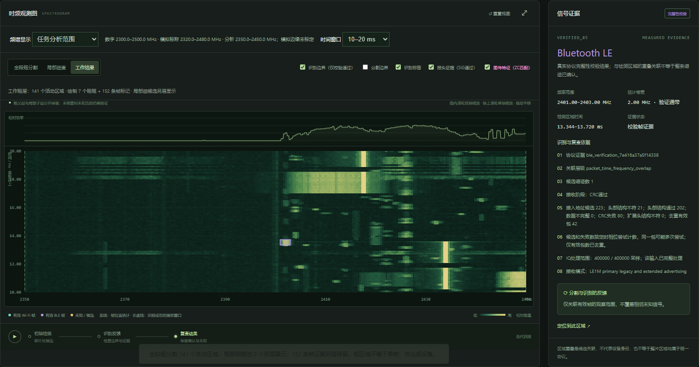
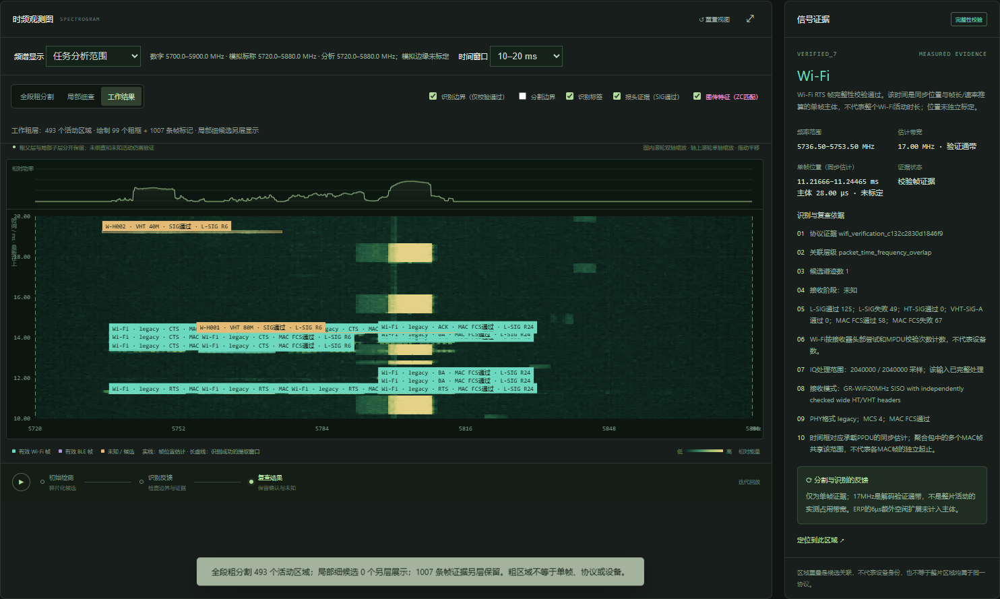
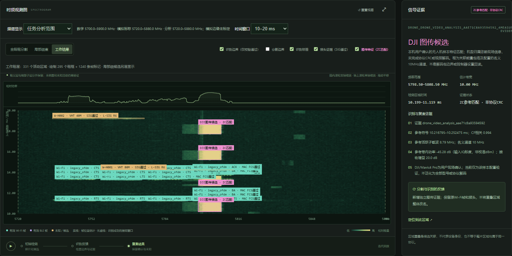
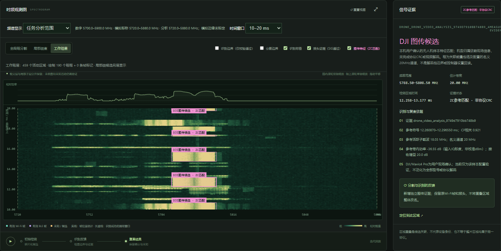
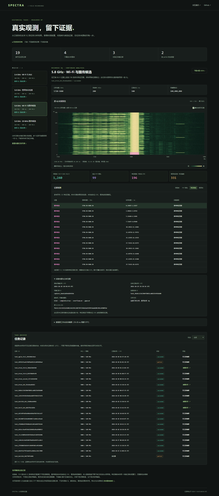

# 历史实采任务与证据

[打开在线实采任务页](https://zh-zehui.github.io/spectra-console-ui/measured/) · [任务索引 JSON](../dist/measured/data/index.json) · [返回首页](../README.md)

本页根据现有 Jetson 网关返回的任务记录整理。读取采用 `GET /edge/tasks` 和 `GET /edge/tasks/{id}/visual`；截图采用历史任务的原工作台与 `GET /edge/tasks/{id}/waterfall-window`。这次整理没有提交新任务或执行新的 RF 采集。

网关在导出时返回 19 条可见任务，包含 17 条 `succeeded` 和 2 条 `partial`；这是当前可见列表，并非所有历史运行目录。完整可见列表及原始状态见索引 JSON 和在线页底部“任务记录”。

## 可核对的来源

精选任务均满足 `data_origin=rf`，采集元数据中 `kind=rf_capture`、`simulated=false`。四个分析案例来自三份 IQ；其中两个案例使用同一采集记录，不应当作独立测量相加。三份采集记录均为 USRP X310、200 MS/s，元数据记载 `complete=true`、`overflow_count=0`、`gaps=[]`。这描述采集完整性，不等于协议识别完整或准确。

| 案例 | 分析任务 ID | 来源任务 ID | 原始采集时间（UTC） |
| --- | --- | --- | --- |
| Wi-Fi / BLE | `task_batch24_dsh_31b06ee649b1` | `task_6642f2a7797a4dd7acdb81ec243c7009` | 2026-10-23 11:54:59.814965 |
| 5.8 GHz 协议检查 | `task_batch_dsh_b02578c6283b` | `task_4d7af074d5bd406e9d9dd781f242cd17` | 2026-10-28 10:48:49.112247 |
| Wi-Fi 与图传候选 | `task_drone_dsh_5b1ddaa81022` | `task_9668c13363904f8092ca082554958600` | 2026-10-28 10:48:49.112247 |
| 20 MHz 图传候选 | `task_drone_third_368a63db4548` | `task_e7bb08a92f9440da91c043ab85f5b1b6` | 2026-10-28 10:41:22.599701 |

“来源任务”表示当前分析任务的重分析或继续分析入口。不同来源任务本身也可能共用 IQ，因此以 `capture_id` 和 `capture_sha256` 判断采集记录是否相同。JSON 同时保留原始采集时间、网关列表中的任务记录时间，二者含义不同。

## 1. 2.4 GHz：Wi-Fi 与 BLE

[在线查看](https://zh-zehui.github.io/spectra-console-ui/measured/#wifi-ble-24) · [公开数据 JSON](../dist/measured/data/wifi-ble-24.json)

- 分析频率 2350–2450 MHz，记录 100 ms，共 20,000,000 个复样本。
- 网关导出 141 个粗活动区域、81 条 Wi-Fi 校验帧、71 条 BLE 校验帧，以及 7 条独立 PHY 报头。
- 计划协议检查 29/29 项完成、失败 0；计划完成不证明所有协议均被识别。
- 原始采集为 `capture_ff299a60dd584a3b`，分析复用了已保存 IQ。



## 2. 5.8 GHz：宽带协议检查

[在线查看](https://zh-zehui.github.io/spectra-console-ui/measured/#wifi-58) · [公开数据 JSON](../dist/measured/data/wifi-58.json)

- 分析频率 5720–5880 MHz，记录 500 ms，共 100,000,000 个复样本。
- 网关导出 493 个粗活动区域、1007 条 Wi-Fi 校验帧、99 条独立 PHY 报头。
- 计划协议检查 35/35 项完成、失败 0；PHY 报头不计作 MAC FCS 通过帧。
- 原始采集为 `capture_bae61ab9ed89459e`。



## 3. 在已有 Wi-Fi 证据上追加图传候选

[在线查看](https://zh-zehui.github.io/spectra-console-ui/measured/#mixed-link) · [公开数据 JSON](../dist/measured/data/mixed-link.json)

此任务复用上一案例相同的 `capture_bae61ab9ed89459e`，但分析流程及继承证据不同，计数不必相同。当前网关输出 1240 条 Wi-Fi 校验帧、99 条独立 PHY 报头和 196 条参考特征匹配；粗活动区域为 331 个。

参考特征配置为 `zc293_u123_30k_observed_v1`，中心约 5803.5 MHz，名义通道 10 MHz，重复间隔估计约 2.5 ms。图传特征与 Wi-Fi 校验帧保存在独立层，重叠区域不整体改名。



## 4. 另一份 IQ 中的 20 MHz 图传候选

[在线查看](https://zh-zehui.github.io/spectra-console-ui/measured/#link-candidate) · [公开数据 JSON](../dist/measured/data/link-candidate.json)

- 另一份采集记录 `capture_36c0da36e5a14595`，分析范围 5720–5880 MHz，记录 500 ms。
- 459 个粗活动区域，`zc601_u252_30k_observed_v1` 在 5798.5 MHz 附近得到 190 条参考匹配；名义通道 20 MHz，重复间隔估计约 2.5 ms。
- 同一频点的 ZC1201/root504、ZC293/root123 配置以及 5750 MHz 的对照配置均为 0 条匹配，完整摘要保留在 JSON 的 `signature_profiles`。
- 本任务没有校验通过的协议帧；190 条特征匹配不能写成 190 条协议 CRC 通过帧，也不能当作无人机数量。



## 展示数据的范围

归档页使用 `/visual` 返回的原始数值绘制 STFT：192 行、512 列、FFT 大小 2048，时间与频率按最大池化生成预览。数据中的第 0 行对应最早文件采样时间，页面将最新时间显示在上方；频率只展示该任务的分析范围。JSON 中保留完整的数字采样频率预览。

工作台截图则来自原 IQ 的 10–20 ms 局部 STFT，分辨率高于全记录预览，两者不是同一缩放级别。归档页不会读取原 IQ 或现场设备，不以放大预览代替重新计算更高时间分辨率的数据。

每案 JSON 包含来源任务、采集 ID、原 IQ SHA-256、采集参数、证据分类计数、全部公开证据条目的频率/时间范围、STFT 预览数值和证据限制。`source_visual_sha256` 对应本机保存的完整 `/visual` 响应，供持有原响应的人核对；完整响应本身不随仓库公开。

公开导出使用字段白名单，不包含设备序列号、网络地址、解码出的标识符、载荷字节、私人路径、凭据或原始 IQ 文件。证据条目的 UI ID 为项目内部索引。

<details>
<summary>查看只读归档页及任务列表预览</summary>



</details>

## 证据限制

1. 校验帧、PHY 报头、参考特征匹配、粗活动区域分别统计，不能互相替代，也不是设备数或准确率。
2. 图传样本的机型归属依赖原任务的现场描述。参考特征模板来自同一采集记录的 0–30 ms 窗口，匹配总数包含该区间，不能当作独立测试集准确率，也不是通用机型识别能力。
3. 图传候选尚未完成协议 CRC、载荷或视频解码；名义 10/20 MHz 配置不等于独立标定的整段占用带宽。
4. 功率为相对值，非校准 dBm；同步估计的时间位置未独立标定。PHY 聚合帧可能共享 PPDU 时间范围。
5. 粗区域不是单帧边界，帧与区域重叠不能确认整个区域的协议。短快照中的 0 帧或 0 匹配不能证明信号不存在。

## 更新归档

先把历史列表与精选 `/visual` GET 响应保存在本机忽略目录中，再执行：

```sh
node scripts/export-measured.mjs qa
```

输入分别为 `qa/measured-task-history.json` 和 `qa/history-<task_id>.json`。导出脚本不会连接设备或提交任务，只验证实采来源并从本地文件提取公开字段。截图仍需从相应历史任务读取，不能用示例截图替代。更新后执行 `npm run check` 和 `npm test`，核对文档中的快照计数。
