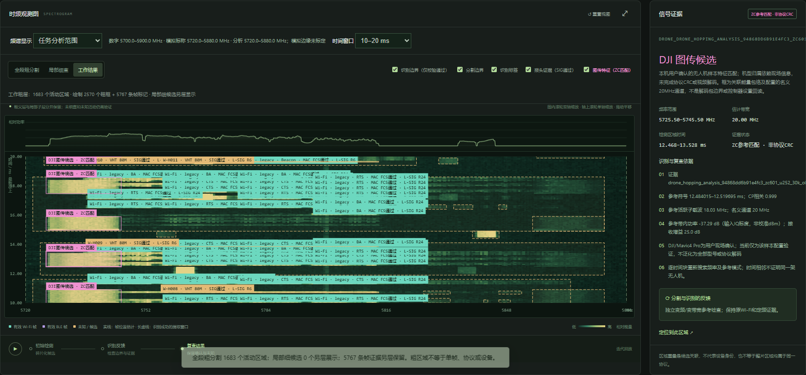

# 指定历史实采任务

[打开实采展示页](https://zh-zehui.github.io/spectra-console-ui/measured/) · [任务 JSON](../dist/measured/data/agile-full.json) · [任务索引](../dist/measured/data/index.json)

GitHub 实采展示仅使用 **`task_agile_full_292630d126a1`**，原来的四个案例已从当前展示和公开数据目录移除。此次替换只调整 GitHub 发布内容，没有修改 Jetson 上的部署代码、任务记录或原始 IQ。

## 来源与采集参数

| 项目 | 原始记录 |
| --- | --- |
| 任务 ID / 状态 | `task_agile_full_292630d126a1` / `succeeded` |
| 继续分析的来源任务 | `task_49fb52faa41f40f8a492211d85969bad` |
| 采集 ID | `capture_9d59d4bd10474035` |
| 实采来源 | `data_origin=rf`、`kind=rf_capture`、`simulated=false` |
| 原始采集时间（UTC） | 2026-10-30 01:46:58.157869 |
| 任务记录时间（UTC） | 2026-10-30 02:57:20.948765 |
| 接收机 | USRP X310 |
| 中心 / 分析范围 | 5800 MHz / 5720–5880 MHz |
| 采样率 / 记录时长 | 200 MS/s / 1000 ms |
| 样本数 | 200,000,000 个复样本 |
| 采集完整性 | `complete=true`、`overflow_count=0`、无采集间隙 |
| 原 IQ SHA-256 | `5548d1f1805b973e19cf142a8199e79c4ea44aa3f10eab41ea5b4f5deb4dc98b` |

该任务延续对已保存 IQ 的分析，采集时间和任务记录时间分别保留，不代表新执行了一次采集。

## 分析结果

| 证据类别 | 网关输出 |
| --- | --- |
| Wi-Fi 完整性校验帧 | 5767 条 |
| 独立 PHY 报头 | 492 条 |
| 图传参考特征候选 | 395 条 |
| 粗活动区域 | 1683 个 |
| 协议计划检查 | 70/70 项，失败 0 |
| 图传候选检查 | 100/100 个时间单元，49,831 次参考检查，无待检查项 |

图传特征候选均为名义 20 MHz 配置。本次记录的结果包含多个候选频率，但 `multiple_bandwidth_candidates=false`，因此不宣称已经观察到带宽变化。

检查完整性只描述已声明时间范围内的能量提议窗口、候选中心与选定配置，不证明发现或识别了全部 RF 信号。

## 记录末段的候选频率变化

参考序列保留两处变化：约 987.48–989.98 ms 为 **5736 → 5758 MHz**；约 989.98–992.48 ms 为 **5758 → 5755.5 MHz**。这些时间来自原始参考样本索引；图中关联能量包络的起止时间与参考符号位置不同。

两处关联均标为 `temporal_compatibility_only_not_emitter_identity`。多处相容频率可能来自一个变频链路，也可能来自多个发射机；尚未解码跳频规律、协议 CRC、载荷或视频，不能确认飞机身份。

## 多时段完整图层截图

截图读取自本机 `8782` 的原工作台。每次先等待对应窗口的原 IQ 局部 STFT 返回，核对起止采样索引，完成重绘后再截图。校验帧、PHY 报头、图传特征和粗分割四个图层均开启。

| 窗口 | Wi-Fi 校验帧 | PHY 报头 | 图传候选 | 粗活动区域 |
| --- | --- | --- | --- | --- |
| 10–20 ms | 69 | 4 | 5 | 18 |
| 500–510 ms | 100 | 8 | 5 | 10 |
| 980–990 ms | 75 | 6 | 5 | 14 |
| 990–1000 ms | 51 | 10 | 4 | 15 |

这是与当前窗口有重叠的证据条目数，不是全任务总数；同一时频位置可能有多条观测。核对记录保存在 [截图记录 JSON](../dist/measured/images/screenshot-records.json)。

**10–20 ms：**



**500–510 ms：**


**980–990 ms：**


**990–1000 ms：**


## 公开数据的范围

`agile-full.json` 从该任务的 `/visual` GET 响应提取，包含真实 STFT 数值、8337 条分层证据记录、采集参数、来源、检查进度和参考频率变化摘要。192×512 的最大池化 STFT 覆盖整段 1000 ms；上方截图则是从同一原 IQ 读取的 10 ms 局部 STFT，分辨率不同。

原始数值保持不变。公开文件不携带解码地址、载荷、设备序列号、私人路径或凭据；原始 IQ 文件仍未上传。`source_visual_sha256` 对应本机保存的完整网关响应，可供持有原响应的人核对。

校验帧、PHY 报头、参考特征匹配和粗活动区域分别统计，不是设备数或识别准确率。相对功率没有校准为 dBm，时间位置为未独立标定的同步估计，名义 20 MHz 配置不等于独立标定的占用带宽。模板是已有记录推导的特征配置，不能泛化为全部机型或通用协议解码。

## 更新这一个任务

将任务列表保存在本地忽略目录的 `qa/agile-task-history.json`，将指定任务的 `/visual` 响应保存在 `qa/history-task_agile_full_292630d126a1.json`，然后执行：

```sh
node scripts/export-measured.mjs qa
npm run check
npm test
```

导出器只读取本地响应文件，公开索引只保留这一个任务。更新只读展示截图可运行 `node tests/measured.mjs --screenshots`；原工作台截图需读取该历史任务的相应时间窗口。
