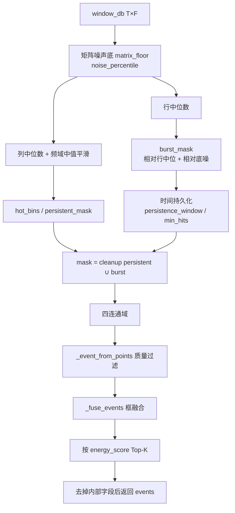

# 传统分割算法（`segmentation_traditional.py`）

本文说明默认算法插件 `traditional`（能量图版本）的处理逻辑、参数含义与输出事件格式。该插件由 `segmentation_engineer_receiver.py` 通过 `segmentation_registry` 加载，对每个 STFT 时间窗独立检测，**不**回传 PSD。

相关文件：

- 实现：`tools/Client/segmentation_traditional.py`
- 参数：`tools/Client/segmentation_config.json` → `algorithms.traditional.params`
- 契约：`tools/Client/segmentation_contracts.py`（`SegmentationRequest`）
- 架构总览：`tools/Client/SEGMENTATION_ARCHITECTURE.md`

---

## 1. 在管线中的位置

```text
5560 STFT 窗 (T × F, dB)
        │
        ▼
segmentation_engineer_receiver
  组窗 SegmentationRequest.window_db
        │
        ▼
TraditionalSegmentationPlugin.detect()
        │
        ▼
events[]（窗内相对坐标 box）
        │
        ▼
5571 PUB → Client 合并/补发 → 5559 → Web 叠框
```

输入：`request.window_db`，形状 `(n_time, n_freq)`，单位 dB。  
输出：最多 `max_events_per_window` 条 event；`box` 的 `x` 为频点、`y` 为窗内时间行（从 0 起）。

---

## 2. 算法目标与设计思路

这是**无深度学习**的能量图分割：

1. 估计整窗噪声底  
2. 找出「持续偏热」的频点（persistent）与「相对本行突发」的格子（burst）  
3. 形态学开运算去噪 → 四连通域成块  
4. 质量门限过滤 → 时频邻近框融合 → 按能量分 Top-K  

Web 瀑布上常见标签 `persistent_signal` / `signal` 即由此产生。

---

## 3. 主流程（`detect`）



### 3.1 噪声底 `matrix_floor`

对有限值取百分位：

```text
matrix_floor = nanpercentile(window_db, noise_percentile)   # 默认 20%
```

后续 SNR、持续门限、突发门限都相对该底噪。

### 3.2 持续信号掩码 `persistent_mask`

1. 每列中位数 `col_level`（沿时间）  
2. 频域中值平滑，宽度 `frequency_smoothing_bins`（默认 5，奇数）  
3. **热频点**：`col_level >= matrix_floor + persistent_threshold_db`（默认 +12 dB）  
4. **格子掩码**：该频点为热，且  
   `value >= matrix_floor + 0.7 * persistent_threshold_db`  

含义：整列长期偏热的频带上，仍高于底噪一定裕量的时频点才算「持续」。

### 3.3 突发掩码 `burst_mask`（简化相对门限）

对每一行取中位数 `row_med`，格子满足：

```text
value 有限
AND (value - row_med) >= cfar_threshold_db      # 默认 10 dB，相对本行
AND value >= matrix_floor + cfar_threshold_db    # 相对整窗底噪
```

再做**时间持久化** `_temporal_persistence`：在 `persistence_window_frames`（默认 5）滑动窗内，同一频点至少 `persistence_min_hits`（默认 3）帧为真，才保留。用于抑制单帧毛刺。

> 说明：配置里仍有 `cfar_training_bins` / `cfar_guard_bins`，但**当前 `detect` 未使用**；此处并非经典 CA-CFAR，而是「行中位数超额 + 底噪门限」。

### 3.4 形态学清理 `_cleanup`

`mask = opening(persistent ∪ burst)`：先腐蚀再膨胀，迭代 `morphology_iterations`（默认 1），去掉孤立噪点、弥合小缝。

### 3.5 连通域 → 候选事件

四邻域（上下左右）连通域，每个域调用 `_event_from_points`。不通过则丢弃。

### 3.6 融合与 Top-K

- `_fuse_events`：按 `(x1, y1)` 排序，贪心合并满足 `_should_fuse` 的框  
- 按 `energy_score` 降序，取前 `max_events_per_window`（默认 20）  
- 删除内部字段 `_points`、`energy_score` 后返回  

---

## 4. 单事件构造与过滤（`_event_from_points`）

对连通点集取外接矩形 `(x1,y1)–(x2,y2)`：

| 检查 | 默认 | 作用 |
|---|---|---|
| `height >= min_event_frames` | 4 | 时间太短不要 |
| `width >= min_event_bins` | 3 | 带宽太窄不要 |
| `width <= max_box_freq_fraction * n_freq` | 0.85·F | 拒绝几乎占满全频带的假块 |
| `snr_db = peak - matrix_floor >= min_snr_db` | 8 | 峰值相对底噪 |
| `occupancy = \|points\|/(h·w)` | ≥0.25（宽框时） | 外接框太空则丢 |

标签：

```text
persistence_fraction = mean(persistent_mask on points)
label = "persistent_signal"  if fraction >= persistent_min_fraction (0.5)
      else "signal"
```

排序用能量分（返回前删除）：

```text
energy_score = max(0, mean_db - matrix_floor) * occupancy * width * height
```

对外 `score`：

```text
score = clip(snr_db / 30, 0, 0.99)
```

帧号：

- 有 `request.frame_ids`：用对应行映射绝对帧  
- 否则：`start_frame_id + y1/y2`  

`box` 始终是**窗内相对坐标**，Web 侧再加 `window_start_frame_id`。

---

## 5. 框融合（`_should_fuse` / `_fuse_events`）

两框同时满足「频域近」且「时域近」才合并：

| 条件 | 默认 | 含义 |
|---|---|---|
| 频域 IoU ≥ `fuse_freq_iou` **或** 频域间隙 ≤ `fuse_freq_gap_bins` | 0.2 / 2 | 同频或相邻频带 |
| 时域间隙 ≤ `fuse_time_gap_frames` | 4 | 时间上挨着或重叠 |

合并后用并集点集重新 `_event_from_points`（可能因质量门限失败，失败则不吞并对方）。

---

## 6. 输出事件字段

| 字段 | 含义 |
|---|---|
| `id` | `ev_traditional_{start_frame_id}_{index}` |
| `label` | `persistent_signal` / `signal` |
| `method` | `"traditional"` |
| `score` | 由 SNR 映射的 0–0.99 |
| `box` | `{x1,y1,x2,y2}` 窗内相对 |
| `window_start_frame_id` / `window_end_frame_id` | 窗与事件结束映射 |
| `event_start_frame_id` / `event_end_frame_id` | 事件绝对帧范围 |
| `center_freq_bin` / `freq_width_bins` / `time_height_frames` | 几何摘要 |
| `peak_db` / `mean_db` / `noise_db` / `snr_db` | 电平 |
| `occupancy` / `persistence_fraction` | 填充率 / 持续占比 |

前端瀑布叠框主要用 `box` + 窗外的 `window_start_frame_id`；`label` 显示为框文字。

---

## 7. 参数一览

来自 `segmentation_config.json`（与构造函数一致）。

### 7.1 当前 `detect` 实际使用

| 参数 | 默认 | 用途 |
|---|---|---|
| `noise_percentile` | 20 | 整窗噪声底百分位 |
| `persistent_threshold_db` | 12 | 热频点相对底噪 |
| `frequency_smoothing_bins` | 5 | 列电平频域中值平滑 |
| `cfar_threshold_db` | 10 | 行相对突发门限（兼底噪裕量） |
| `min_event_frames` / `min_event_bins` | 4 / 3 | 最小框尺寸 |
| `morphology_iterations` | 1 | 开运算次数 |
| `persistence_window_frames` / `persistence_min_hits` | 5 / 3 | 突发时间持久化 |
| `persistent_min_fraction` | 0.5 | 判 `persistent_signal` |
| `min_snr_db` | 8 | 峰值 SNR 门限 |
| `max_box_freq_fraction` | 0.85 | 最大带宽占比 |
| `min_box_occupancy` | 0.25 | 外接框占用率 |
| `fuse_freq_iou` / `fuse_freq_gap_bins` / `fuse_time_gap_frames` | 0.2 / 2 / 4 | 融合邻域 |
| `max_events_per_window` | 20 | Top-K |

### 7.2 已读入但当前未参与 `detect`

| 参数 | 说明 |
|---|---|
| `global_noise_percentile` | 构造时校验，检测路径未引用 |
| `global_margin_db` | 同上 |
| `cfar_training_bins` / `cfar_guard_bins` | 经典 CFAR 预留，现实现未用 |

调参时优先改 **§7.1**；若需真正 CA-CFAR，需改代码接入训练/保护单元。

---

## 8. 调参建议（工程向）

| 现象 | 可调方向 |
|---|---|
| 框太多、噪声虚警 | ↑ `cfar_threshold_db` / `persistent_threshold_db` / `min_snr_db`；↑ `min_event_*` |
| 弱信号漏检 | ↓ 上述门限；↓ `persistence_min_hits` |
| 同一信号碎成多框 | ↑ `fuse_freq_gap_bins` / `fuse_time_gap_frames`；↓ `fuse_freq_iou` |
| 全频带大框 | ↓ `max_box_freq_fraction`；↑ `min_box_occupancy` |
| 间歇信号标不成 persistent | ↓ `persistent_min_fraction` 或 ↓ `persistent_threshold_db` |

改参后需重启分割工程师进程（或整条 Client 流采集）使 JSON 生效。

---

## 9. 与模型算法、瀑布链路的关系

- 与 `segmentation_model.py` 并列插件；默认 `default_algorithm: traditional`  
- 只产出 events，不上传 `stft_frame_db`；瀑布 PSD 仍走 Client 订 5560 上行（见 `docs/waterfall-pipeline.md`）  
- Web 叠框：`y_abs = window_start_frame_id + box.y`  

---

## 10. 一句话

**对每个 STFT 窗：估噪声底 → 持续热频带 ∪ 行相对突发 → 开运算连通域 → SNR/尺寸/占用率过滤 → 时频邻域融合 → 能量 Top-K，输出带 `persistent_signal`/`signal` 标签的窗内框。**
